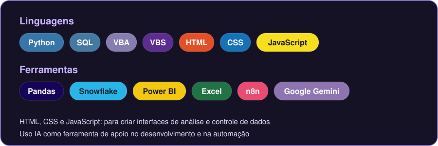

  

  

  Estudante de <b>Ciências Econômicas</b> e <b>Inteligência de Mercado e Análise de Dados</b> · São Luís - MA 
  Conciliação financeira e automação de processos no setor de energia ⚡

  &nbsp;
  &nbsp;
  

## 💻 Linguagens e ferramentas

  

## 🚀 Projetos em destaque

| Projeto | O que é |
|---|---|
| 🌐 [Portfólio](https://brendacarmosa-create.github.io) | Meus projetos reunidos em um só lugar |
| 🤖 [Agente IA Essenza](https://github.com/brendacarmosa-create/agenteIA_Essenza) | Agente interno de IA para uma clínica fictícia, com n8n e Gemini |
| 📈 [Análise de vendas Eletro](https://github.com/brendacarmosa-create/Analise-indicador-vendas-eletro-python) | 10 mil vendas de 2025 com SQLite e dashboard em Python |

## 📚 Certificação

🏅 CPA-20 (ANBIMA)

## 🔥 Constância

  

  

