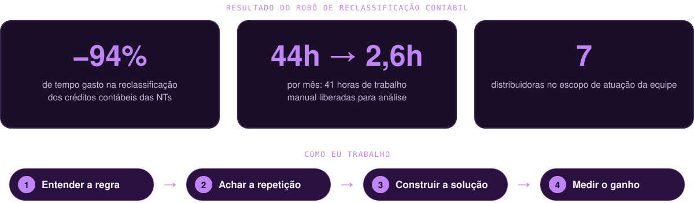
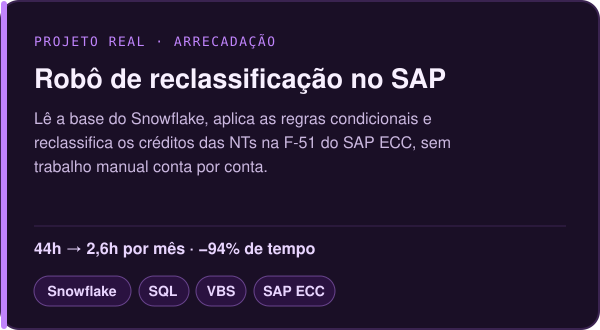
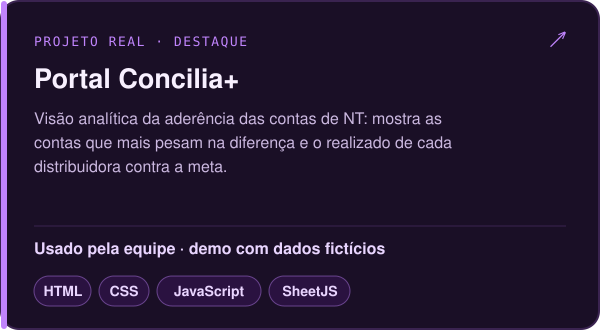
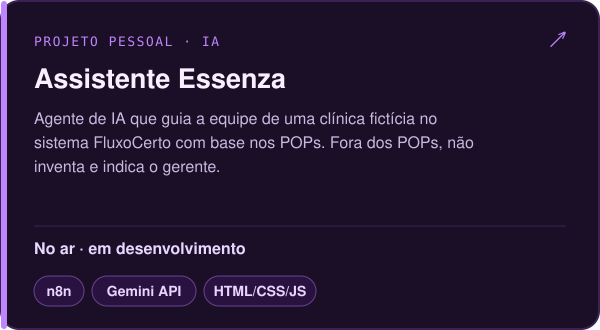
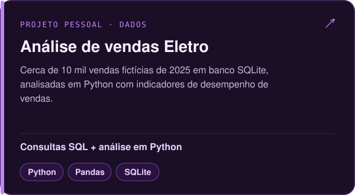
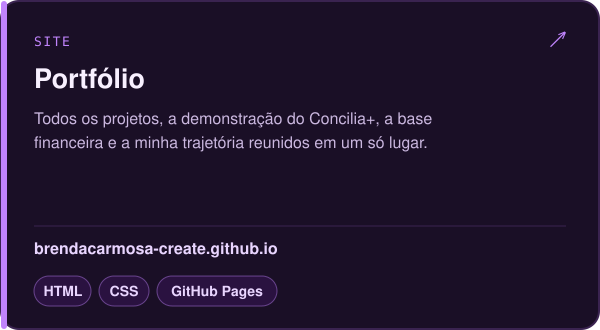
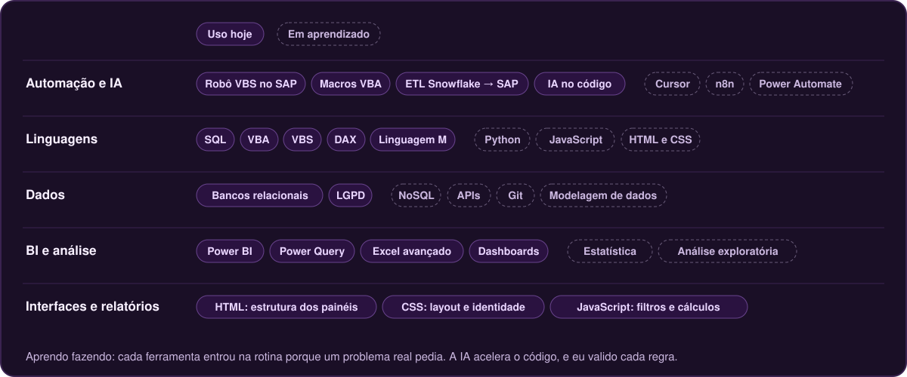

Técnica em Informática, estudante de **Ciências Econômicas** e **Inteligência de Mercado e Análise de Dados** · CPA-20 (ANBIMA) · São Luís, MA 
Atuo com análise de dados, conciliação financeira e automação de processos, utilizando SQL, Snowflake, VBA, VBS e Inteligência Artificial como apoio ao desenvolvimento de soluções. Uno conhecimentos técnicos e de negócio para identificar oportunidades de melhoria, estruturar regras e validar resultados.

  

## ⚡ Projetos

  
  

  
  

  
  

Os projetos do estágio têm código, dados e regras internas confidenciais. A demonstração do Concilia+ no portfólio usa dados fictícios.

## 🧰 Conhecimentos

### 🗄️ Bancos de dados

<b>💰 Base financeira</b>

 

- **Controladoria (Grupo Negreiros):** fluxo de caixa projetado, projeção de receita e cenários.
- **Gestão financeira (Centro Administrativo DNT):** fluxo de caixa diário, conciliação de cartões e contas a pagar de 8 clínicas da rede.
- **CPA-20 e Economia:** mercado financeiro, renda fixa e variável, macroeconomia e análise de empresas.

<b>🎓 Formação e certificações</b>

 

| Formação | Status |
|---|---|
| Ciências Econômicas · UniDonBosco | Cursando · previsão dez/2027 |
| Inteligência de Mercado e Análise de Dados · Anhanguera | Cursando · previsão jun/2028 |
| Técnica em Informática – Programação · IEMA | Concluído, 2018 |
| CPA-20 · ANBIMA | Certificada |
| SQL (FGV) · Power BI e Data Science (Data Science Academy) | Cursos |

🌎 Intercâmbio de seis meses na Argentina (2017) · Espanhol intermediário

 

**Aberta a oportunidades de estágio em finanças, estratégia e automação de processos. 💜**

